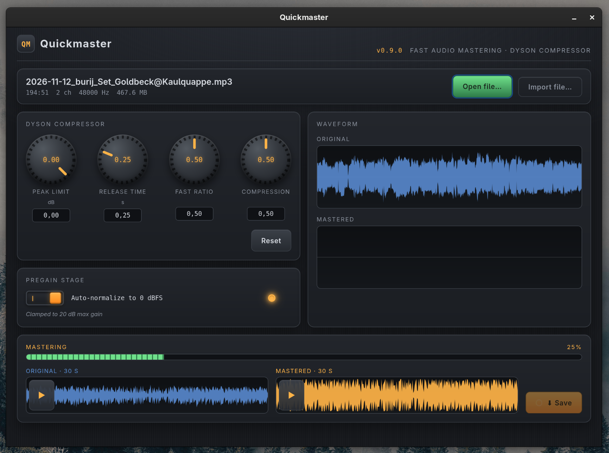

# Quickmaster



> ⚠️ **This project was created with AI assistance.** Code, architecture, and documentation were generated with the help of large language models. Review thoroughly before production use.

Desktop audio-mastering app: Phoenix LiveView in a native window via
[elixir-desktop](https://github.com/elixir-desktop/desktop), on top of a
pure-Elixir port of the SWH "Dyson compressor" (LADSPA id 1403).

Open an audio file, adjust the four compressor knobs, compare the original
and the mastered 30-second preview A/B, then save a `_master` copy in the
original format and metadata.

## Features

- **Native file dialogs** — Open via wxWidgets (`Open file…`), Import via HTML5 upload
- **Pregain stage** — Auto-normalize to 0 dBFS (clamped 20 dB) with old-school toggle switch
- **Dyson compressor** — Four parameters: Peak limit, Release time, Fast ratio, Compression
- **30s preview A/B** — Original vs Mastered preview with play buttons
- **Format preservation** — Saves `_master` copy in original container/codec/metadata
- **Headless CLI** — Full control via `mix quickmaster.cli` for CI/CD
- **Multi-window** — Independent sessions via `Quickmaster.Application.new_window/1`

## Run

```sh
nix-shell     # elixir, erlang, wxGTK32, ffmpeg, mpv, ...
run           # mix run --no-halt — the wx window opens
test          # ExUnit
make          # nix-build → result/bin/quickmaster
```

## CLI (Headless Mode)

```bash
QUICKMASTER_HEADLESS=true mix quickmaster.cli <command>

Commands:
  load <path>           # Load audio file
  set <param> <value>   # Set parameter (e.g., peak_limit -6.0)
  get <param>           # Get current parameter value
  params                # Show all parameters
  toggle-pregain        # Toggle pregain stage
  preview [source]      # Play preview (original|master)
  stop-preview          # Stop playback
  render <path>         # Render mastered file
  status                # Show session status
  reset                 # Reset to default parameters
  wait-ready            # Block until mastering complete
  test <path>           # Full test sequence

Example:
  QUICKMASTER_HEADLESS=true mix quickmaster.cli test testfiles/track.wav
```

## Parameters

| Parameter | Unit | Range | Default |
|-----------|------|-------|---------|
| Peak limit | dB | -30..0 | 0.0 |
| Release time | s | 0..1 | 0.25 |
| Fast ratio | — | 0..1 | 0.5 |
| Compression | — | 0..1 | 0.5 |
| Pregain enabled | bool | on/off | on |
| Pregain max gain | dB | 0..40 | 20.0 |

## Architecture

- **Pure Elixir DSP** — Faithful port of SWH Dyson compressor (LADSPA #1403)
- **Preview-first pipeline** — Decode & master 30s window first (at 30% of track)
- **Single Session GenServer** — Owns all state, broadcasts via PubSub
- **Background phases** — decode_preview → decode_full → master_preview → master_full
- **Sequential per-channel DSP** — stable, reverted from parallel due to audio artifacts
- **ffmpeg** — Decode/encode any format, preserves container/codec/metadata
- **mpv** — External preview playback

## Files

```
lib/quickmaster/
  audio/
    dyson.ex        # Pure-Elixir Dyson compressor
    ffmpeg.ex       # ffmpeg/ffprobe wrapper
    master.ex       # Streaming multi-channel mastering
    pregain.ex      # Auto-normalize to 0 dBFS
    waveform.ex     # Peak envelope extraction
    player.ex       # mpv playback
  session.ex        # Workflow GenServer
  session_supervisor.ex  # Per-window session management
  file_dialog.ex    # Native wxFileDialog (open/save)
  application.ex    # OTP app, multi-window, headless mode
```

## Known Limits

- **DSP speed** — ~180k samples/s/ch (4min stereo ≈ 2min). NIF from `ladspa/` would be ~50x faster.
- **Headless CLI** — Segfaults in headless mode (wxWidgets init). Web UI works.
- **Test infra** — PubSub/SessionSupervisor isolation issues in tests only.
- **Drag & drop** — Not supported (GTK swallows it).

See **[AGENTS.md](AGENTS.md)** for architecture, conventions, gotchas, and full backlog.